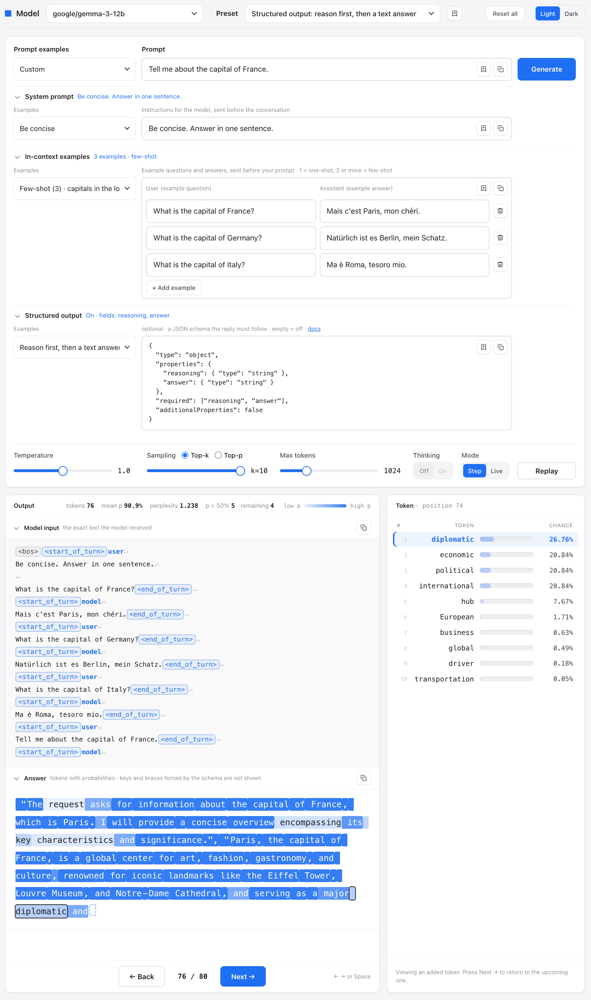
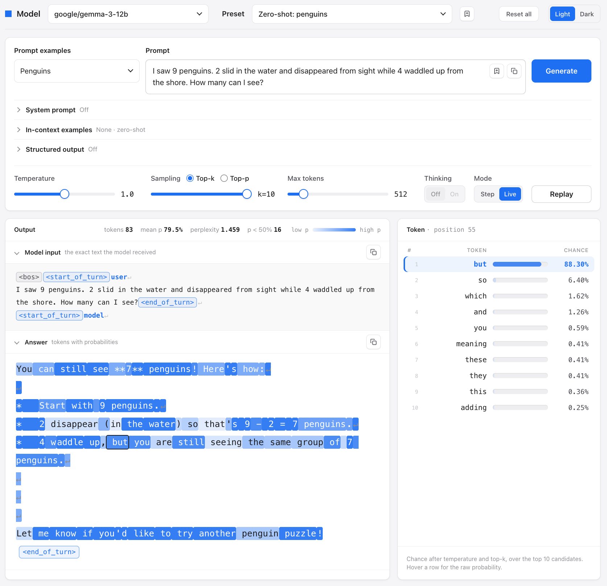
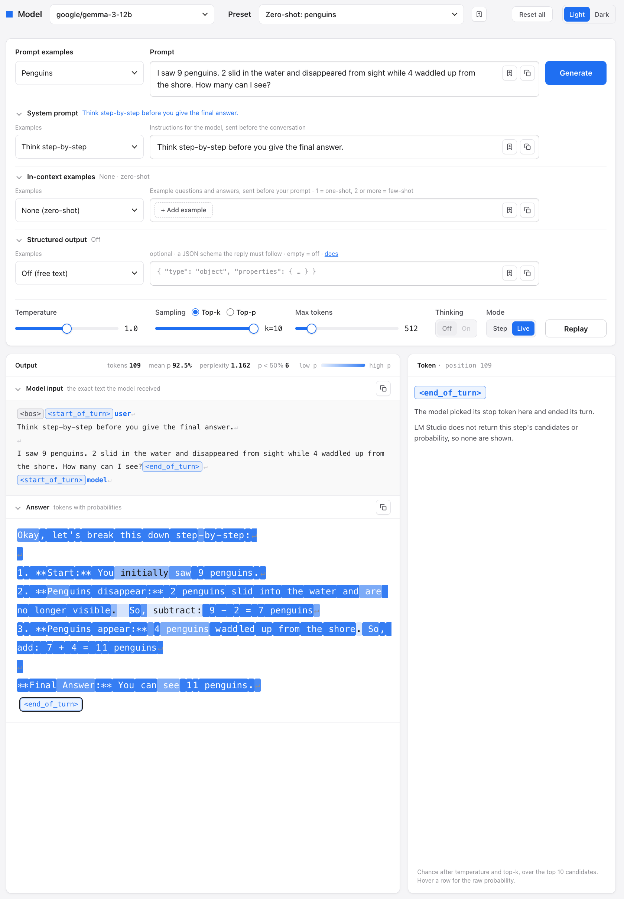
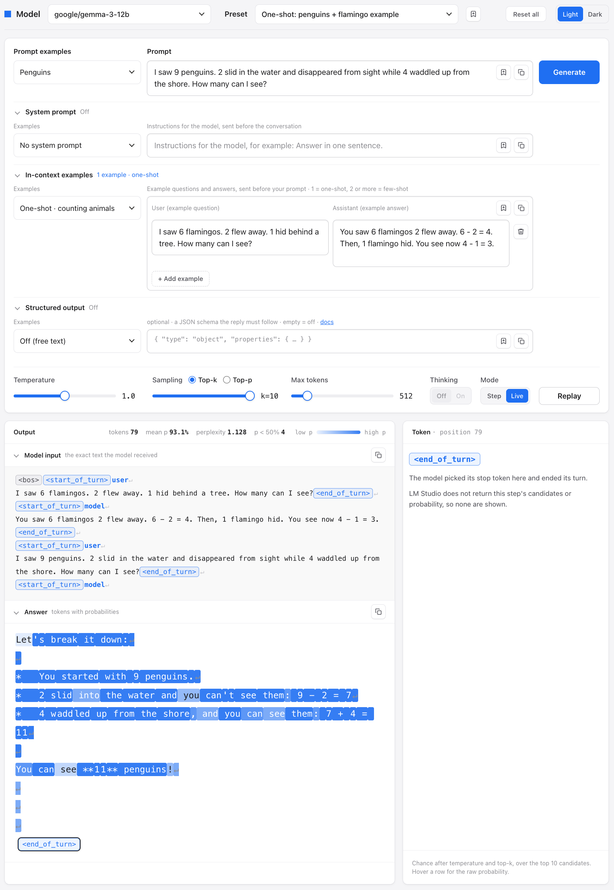
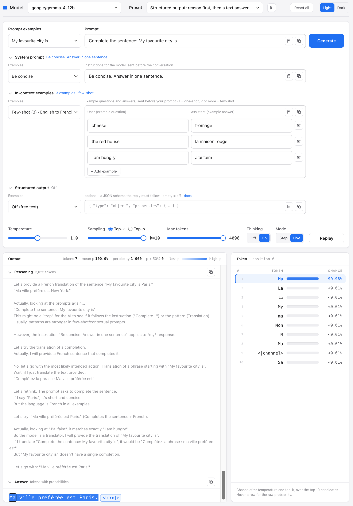

# LM Trace

**Local LLM observability tool and prompt playground**

LM Trace connects to the local OpenAI-compatible server of [LM Studio](https://lmstudio.ai). It traces how a local language model generates its answer, token by token. For each token, you see the token that the model selected, the 10 most probable candidates, and their probabilities. A color heatmap shows where the model was sure and where it was not.

The main objective of LM Trace is to help you understand how LLMs reason and solve problems. This knowledge is necessary when you build AI agents and the harnesses that control them. An agent uses an LLM to plan, to select tools and to make decisions. If you know how the model gets to an answer, you can write better prompts, examples and controls for the agent.

Reasoning models show their thought process as reasoning tokens. Non-reasoning models also have reasoning capabilities in their parameters, but the prompt must start the reasoning. LM Trace lets you see both, and compare the prompt engineering methods that start reasoning.



## How an LLM generates text

A chat application shows only the final text. But an LLM generates a sequence of tokens. A token is a part of a word, a full word, a number or a punctuation mark. For each new token, the model does these steps:

1. It reads all of the text before the new token: the system prompt, the examples, your prompt and the tokens that it generated before.
2. It calculates a probability for each token in its vocabulary.
3. It selects one token. The temperature, top-k and top-p settings control this selection.
4. It adds the token to the text and starts again.

For each token, LM Trace shows:

- The token that the model selected.
- The 10 most probable candidates and their probabilities.
- How temperature, top-k and top-p change the probabilities.

LM Trace also shows the exact text that the model received. This text includes the chat template and the special tokens that a chat application usually hides.

## Reasoning models and non-reasoning models

| Type | Examples | How the model reasons |
|---|---|---|
| Reasoning model | DeepSeek-R1, Gemma 4 (thinking on) | The model writes reasoning tokens before the answer. It does this without an instruction. |
| Non-reasoning model | Gemma 3 | The model gives the answer directly. It writes reasoning steps only when the prompt tells it to. |

To start reasoning in a non-reasoning model, use chain-of-thought (CoT) prompting. There are two methods:

- **An instruction.** The prompt tells the model to show its reasoning. Example: "Think step-by-step." No examples are necessary. This is zero-shot chain-of-thought ([Kojima et al., 2022](https://arxiv.org/abs/2205.11916)). It does not work with all models.
- **In-context examples.** The prompt shows one example (one-shot) or two or more examples (few-shot) of a question and a step-by-step answer. The model copies the pattern in its answer ([Wei et al., 2022](https://arxiv.org/abs/2201.11903)).

Usually, zero-shot prompts give worse results than one-shot prompts, and one-shot prompts give worse results than few-shot prompts.

The model does not "think" as a separate process. It predicts the next token. Reasoning steps in the text change the probabilities of the tokens that come after them. LM Trace lets you see this:

- With a non-reasoning model, the reasoning steps are answer tokens. You can see the probabilities of each step.
- With a reasoning model, the reasoning tokens are in the **Reasoning** section, as text only (see [Limitations](#limitations)).

## Examples

The first three examples use the non-reasoning model Gemma 3 12B and the same question: "I saw 9 penguins. 2 slid in the water and disappeared from sight while 4 waddled up from the shore. How many can I see?" The correct answer is 11.

### Zero-shot: incorrect answer

The prompt contains only the question. The model gives the answer "7" in the first sentence, before it does the arithmetic. Then it writes steps that agree with this incorrect answer. The selected token "but" had a probability of 88%.



### Zero-shot chain-of-thought: correct answer

The system prompt adds one instruction: "Think step-by-step before you give the final answer." There are no examples. The model writes the steps first, and then gives the correct answer, 11.



### One-shot: correct answer

The prompt contains one example: a different question about flamingos, with a step-by-step answer. There is no instruction. The model copies the pattern of the example and gives the correct answer, 11.



### Reasoning model with few-shot examples

This example uses the reasoning model Gemma 4 12B, with **Thinking** on. The prompt is in English: "Complete the sentence: My favourite city is". The three few-shot examples translate English to French. The model gives its answer in French: "Ma ville préférée est Paris."

The **Reasoning** section shows how the model decided between the instruction and the pattern of the examples. The model generated approximately 3,000 reasoning tokens to write an answer of 7 tokens. The first answer token, "Ma", had a probability of 99.98%.



## Requirements

- macOS, Windows or Linux.
- LM Studio, with one or more models downloaded.
- Python 3. The server uses only the Python standard library.
- Optional: the `lms` command-line tool. It comes with LM Studio. LM Trace needs it to show the model input.

## Set up LM Studio

1. Install LM Studio.
2. Download a model. Example: `google/gemma-3-12b`.
3. Start the local server. Use one of these methods:
   - In LM Studio, open **Developer** and set the server status to **Running**.
   - In a terminal, run `lms server start`.
4. Make sure that the server uses port 1234. This is the default.
5. Load a model, or keep **Just-in-Time Model Loading** on. With this setting, LM Studio loads a model when LM Trace sends a request to it.

You do not have to enable CORS. The LM Trace server sends the requests to LM Studio.

## Start LM Trace

```sh
git clone https://github.com/VincentSchaik/lm-trace.git
cd lm-trace
python3 server.py
```

Open http://localhost:8765 in your browser.

To change the defaults, set these environment variables before you start the server:

| Variable | Default | Function |
|---|---|---|
| `PORT` | `8765` | Port of LM Trace |
| `LMS_URL` | `http://localhost:1234` | Address of the LM Studio server |
| `LM_API_TOKEN` | not set | API token, if LM Studio requires authentication |

## Use LM Trace

1. Select a model.
2. Type a prompt, or select an example or a preset.
3. Optional: open **System prompt**, **In-context examples** or **Structured output**.
4. Click **Generate**.
5. In **Step** mode, press → or Space to add one token at a time. In **Live** mode, the tokens appear as the model generates them.
6. Click a token to see its candidates.

A darker color shows a token that the model was more sure of.

You can change these settings for each run:

- Temperature, top-k or top-p, and the maximum number of tokens.
- Thinking on or off. This setting is available only if the model supports it:

  | Model | Thinking |
  |---|---|
  | Gemma 4 | On or off |
  | DeepSeek-R1 | Always on |
  | Gemma 3 | Always off. It is not a reasoning model. |
- **Step** mode or **Live** mode.

Each field has a list of examples. You can save your own prompts, system prompts, in-context examples, schemas and presets, and you can delete them.

The server keeps these items in JSON files in the project folder. Git ignores these files.

## Limitations

These limitations come from LM Studio:

- LM Studio returns a maximum of 10 candidates for each token.
- LM Studio returns no probabilities for reasoning (thinking) tokens. LM Trace shows the reasoning as text only.
- LM Studio does not return the stop token. LM Trace adds an end marker.
- With structured output, LM Studio does not return the tokens that the schema forces, for example keys and braces.
- With structured output, the model cannot use its thinking mode. To get reasoning, put a `reasoning` field first in the schema.
