# LM Trace

**A hands-on guide to how LLMs and agents work**

LM Trace started as a way to look inside a language model while it reasons and generates an answer. Now it is also a step-by-step guide to building a simple AI agent and the harness that controls it. Each module adds one part: first reasoning and prompting, then memory, tool use, planning and reflection. Clear illustrations, real data and practical templates show how the parts fit together, from the language model itself to the system that lets it take action.

LM Trace connects to the local OpenAI-compatible server of [LM Studio](https://lmstudio.ai). It traces how a local language model generates its answer, token by token. For each token, you see the token that the model selected, the 10 most probable candidates, and their probabilities. A color heatmap shows where the model was sure and where it was not.

The main objective of LM Trace is to help you understand how LLMs reason and solve problems. This knowledge is necessary when you build AI agents and the harnesses that control them. An agent uses an LLM to plan, to select tools and to make decisions. If you know how the model gets to an answer, you can write better prompts, examples and controls for the agent.

Reasoning models show their thought process as reasoning tokens. Non-reasoning models also have reasoning capabilities in their parameters, but the prompt must start the reasoning. LM Trace lets you see both, and compare the prompt engineering methods that start reasoning.

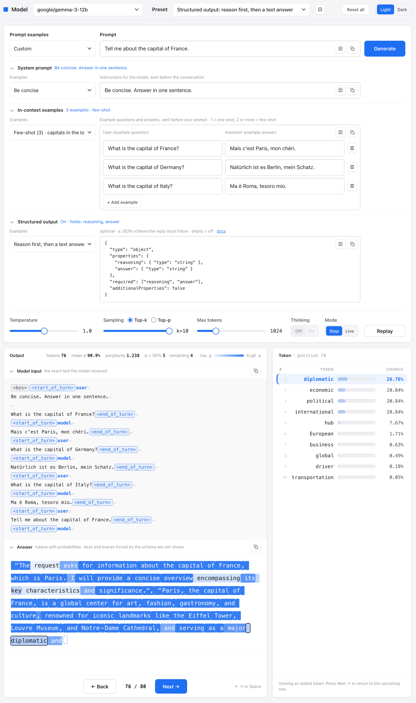

## Quick start with an AI agent

Tell your coding agent (for example Claude Code or Codex): "Set up and start https://github.com/VincentSchaik/lm-trace".

**Instructions for the agent:**

1. Make sure that LM Studio is installed. Find the `lms` tool: use `lms` if it is on the PATH, or else `~/.lmstudio/bin/lms` (on Windows: `%USERPROFILE%\.lmstudio\bin\lms.exe`). If you cannot find it, stop. Tell the user to install LM Studio from https://lmstudio.ai and to open it one time.
2. Run `lms ls` to list the downloaded models. If there is no model, ask the user before you download one. Recommended models:
   - `google/gemma-3-12b`: non-reasoning, approximately 8 GB.
   - `google/gemma-4-12b`: reasoning, thinking on or off, approximately 7 GB.

   To download, run `lms get <model> -y`.
3. Run `lms server start`. Then run `lms server status` and make sure that the server is on port 1234.
4. Run `lms load <model> -y`.
5. Clone the repo and start the server in the background:

   ```sh
   git clone https://github.com/VincentSchaik/lm-trace.git
   cd lm-trace
   nohup python3 server.py > lm-trace.log 2>&1 &
   ```

6. Make sure that http://localhost:8765 responds. Then open it in the browser of the user.
7. Tell the user to stop the server with `kill <pid>` when they are done.

## How an LLM generates text

A chat application shows only the final text. But an LLM generates a sequence of tokens. A token is a part of a word, a full word, a number or a punctuation mark. For each new token, the model does these steps:

1. It reads all of the text before the new token: the system prompt, the examples, your prompt and the tokens that it generated before.
2. It calculates a probability for each token in its vocabulary.
3. It selects one token. The temperature, top-k and top-p settings control this selection.
4. It adds the token to the text and starts again.

For each token, LM Trace shows:

- The token that the model selected.
- The 10 most probable candidates and their probabilities.
- How temperature, top-k and top-p change the probabilities.

LM Trace also shows the exact text that the model received. This text includes the chat template and the special tokens that a chat application usually hides.

## Reasoning models and non-reasoning models

| Type | Examples | How the model reasons |
|---|---|---|
| Reasoning model | DeepSeek-R1, Gemma 4 (thinking on) | The model writes reasoning tokens before the answer. It does this without an instruction. |
| Non-reasoning model | Gemma 3 | The model gives the answer directly. It writes reasoning steps only when the prompt tells it to. |

To start reasoning in a non-reasoning model, use chain-of-thought (CoT) prompting. There are two methods:

- **An instruction.** The prompt tells the model to show its reasoning. Example: "Think step-by-step." No examples are necessary. This is zero-shot chain-of-thought ([Kojima et al., 2022](https://arxiv.org/abs/2205.11916)). It does not work with all models.
- **In-context examples.** The prompt shows one example (one-shot) or two or more examples (few-shot) of a question and a step-by-step answer. The model copies the pattern in its answer ([Wei et al., 2022](https://arxiv.org/abs/2201.11903)).

Usually, zero-shot prompts give worse results than one-shot prompts, and one-shot prompts give worse results than few-shot prompts.

The model does not "think" as a separate process. It predicts the next token. Reasoning steps in the text change the probabilities of the tokens that come after them. LM Trace lets you see this:

- With a non-reasoning model, the reasoning steps are answer tokens. You can see the probabilities of each step.
- With a reasoning model, the reasoning tokens are in the **Reasoning** section, as text only (see [Limitations](#limitations)).

## Examples

The first three examples use the non-reasoning model Gemma 3 12B and the same question: "I saw 9 penguins. 2 slid in the water and disappeared from sight while 4 waddled up from the shore. How many can I see?" The correct answer is 11. The penguin question and the flamingo example come from *An Illustrated Guide to AI Agents* (see [References and credits](#references-and-credits)).

### Zero-shot: incorrect answer

The prompt contains only the question. The model gives the answer "7" in the first sentence, before it does the arithmetic. Then it writes steps that agree with this incorrect answer. The selected token "but" had a probability of 88%.

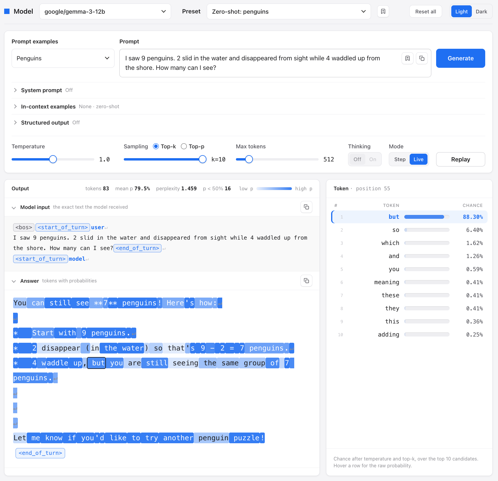

### Zero-shot chain-of-thought: correct answer

The prompt adds one sentence at the end of the question: "Think step-by-step." There is no system prompt and there are no examples. The model writes the steps first, and then gives the correct answer, 11.

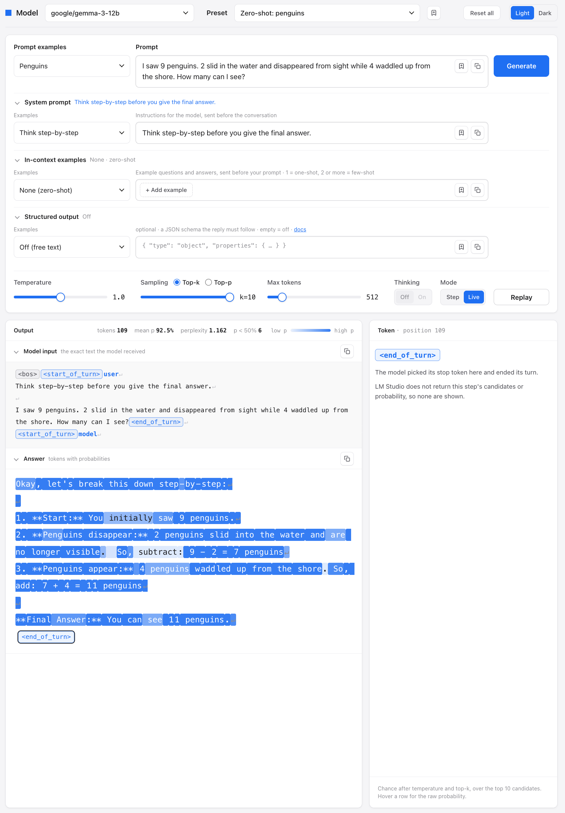

### One-shot: correct answer

The prompt contains one example: a different question about flamingos, with a step-by-step answer. There is no instruction. The model copies the pattern of the example and gives the correct answer, 11.

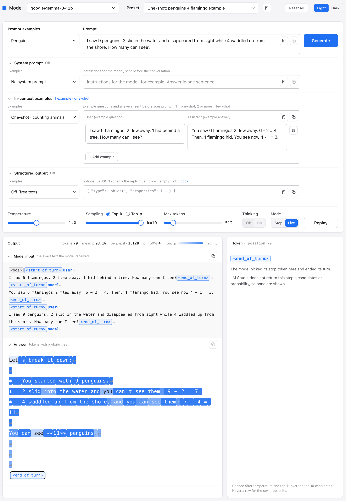

### Reasoning model with few-shot examples

This example uses the reasoning model Gemma 4 12B, with **Reasoning** on. The prompt is in English: "Complete the sentence: My favourite city is". The three few-shot examples translate English to French. The model gives its answer in French: "Ma ville préférée est Paris."

The **Reasoning** section shows how the model decided between the instruction and the pattern of the examples. The model generated approximately 3,000 reasoning tokens to write an answer of 7 tokens. The first answer token, "Ma", had a probability of 99.98%.

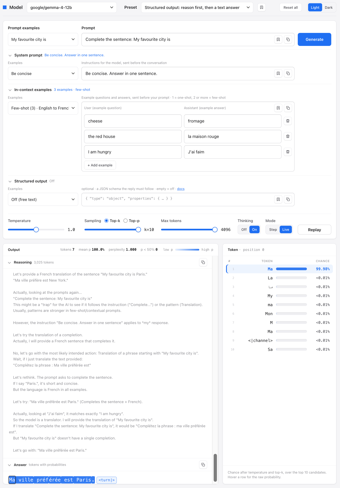

## Requirements

- macOS, Windows or Linux.
- LM Studio, with one or more models downloaded.
- Python 3.10 or later. The server uses only the Python standard library.
- Optional: [uv](https://docs.astral.sh/uv/), to install the optional packages below.
- Optional: the `lms` command-line tool. It comes with LM Studio. LM Trace needs it to show the model input.
- Optional: the LM Studio Python SDK (`lmstudio`). The Tokenizer page needs it to show the tokens. LM Studio has no tokenize endpoint over HTTP.
- Optional: Chroma (`chromadb`). The Memory page uses it as the vector database. Without it, the page keeps the vectors in the browser.
- For the Memory page: an embedding model in LM Studio, for example EmbeddingGemma.

## Set up LM Studio

1. Install LM Studio.
2. Download a model. Example: `google/gemma-3-12b`.
3. Start the local server. Use one of these methods:
   - In LM Studio, open **Developer** and set the server status to **Running**.
   - In a terminal, run `lms server start`.
4. Make sure that the server uses port 1234. This is the default.
5. Load a model, or keep **Just-in-Time Model Loading** on. With this setting, LM Studio loads a model when LM Trace sends a request to it.
6. Optional: turn off **JIT models auto-evict** (LM Studio settings, section On-Demand Loading and Model TTL). The RAG and Memory pages use two models: a chat model and an embedding model. With auto-evict on, LM Studio keeps only one of them loaded, so it loads both again at each message. The **Settings** page of LM Trace shows the current value of this setting and of **Max idle TTL**. It does not change them.

You do not have to enable CORS. The LM Trace server sends the requests to LM Studio.

## Start LM Trace

```sh
git clone https://github.com/VincentSchaik/lm-trace.git
cd lm-trace
python3 server.py
```

Open http://localhost:8765 in your browser.

To install the optional packages, use uv. The extras are in `pyproject.toml`:

```sh
uv sync --extra embeddings --extra memory   # LM Studio SDK and Chroma
uv run server.py
```

| Extra | Package | Used by |
|---|---|---|
| `embeddings` | `lmstudio` | Tokens on the Tokenizer page |
| `memory` | `chromadb` | Vector database on the Memory page |

To change the defaults, set these environment variables before you start the server:

| Variable | Default | Function |
|---|---|---|
| `PORT` | `8765` | Port of LM Trace |
| `LMS_URL` | `http://localhost:1234` | Address of the LM Studio server |
| `LM_API_TOKEN` | not set | API token, if LM Studio requires authentication |

## The message box

All pages use the same message box. Type your text, select a model, and click the round **Send** button (↑). While the model runs, the same button is **Stop** (■).

Click the model name in the box to open the model menu:

- **Currently loaded:** the models that LM Studio has in memory now. Click **Eject** to unload a model. LM Studio loads it again at the next request.
- **Your models:** all language models in LM Studio. The icons show what LM Studio reports for each model: tool use, vision and reasoning.
- **Embedding model** (RAG and Memory only): the model that turns text into vectors for the search.
- **Reasoning** (only for models that support it): **On** or **Off**. Off sends `reasoning_effort: "none"` in the request. LM Trace keeps the value for each model.

Hold the pointer on the model name to see the model card: the data of LM Studio and the model page on Hugging Face.

## Use LM Trace

1. Select an example, or type a prompt.
2. Optional: open **System prompt**, **In-context examples** or **Structured output**.
3. Select a model in the message box, and click **Send** (or press ⌘ + Enter).
4. In **Step** mode, press → or Space to add one token at a time. In **Auto** mode, the tokens appear as the model generates them.
5. Click a token to see its candidates.

A darker color shows a token that the model was more sure of.

You can change these settings for each run:

- Temperature, top-k or top-p, and the maximum number of tokens.
- Reasoning on or off, in the model menu. LM Studio reports which options each model allows:

  | Model | Reasoning |
  |---|---|
  | Gemma 4, Qwen3 | On or off |
  | DeepSeek-R1, GLM-4.6V | Always on |
  | Gemma 3 | Not a reasoning model |
- **Step** mode or **Auto** mode.

The **Example** list has three groups:

- **Prompts:** a prompt only.
- **Setups:** a whole page, to compare prompting methods: the prompt, the system prompt, the in-context examples, the structured output and the settings (temperature, sampling, maximum tokens and reasoning).
- **Your examples:** the setups that you saved. Click the save icon in the prompt box to save the whole page. Select a saved example and click the delete icon to delete it.

The system prompt, the in-context examples and the structured output also have their own lists of examples. You can save your own items in these lists, and delete them.

The server keeps these items in JSON files in the project folder. Git ignores these files.

## Tokenizer

Open **Tokenizer** in the sidebar. The page shows the input of the model in two steps, with the real data of the selected model:

1. **Tokens:** the tokenizer cuts your text into tokens and gives each token an ID. The model receives only the list of IDs.
2. **Embeddings:** the model takes the row of each ID from its embedding table: a list of numbers. For Gemma 3 12B, the table has 262,208 rows of 3,840 numbers. These lists are the input of the first layer.

Click a token to see its whole vector. The same token always gets the same row, in any sentence: the layers of the model add the context later.

The page reads the embedding table directly from the model files, because LM Studio does not return it. This works for models in safetensors (MLX) format, plain or quantized. It does not work for GGUF models yet.

## Memory

Open **Memory** in the sidebar. A language model has no memory: the harness decides what goes into each request. The page sends the same messages to two chats, A and B, with a different memory method on each side. You compare the answers, the prompt tokens and the extra LLM calls.

| Type | Methods |
|---|---|
| Short-term memory (this chat) | None, Full history, Trimming (last N turns), Summary (a running summary, written by an extra LLM call) |
| Long-term memory (saved facts) | Off, Memory files (one `.md` file per fact and a `MEMORY.md` index in the system prompt, as Claude Code does), RAG (the top k facts from a vector search in Chroma) |

How to use it:

1. Select an example, then click **Run**. The five examples follow chapter 4 of *An Illustrated Guide to AI Agents*. Click **New chat** (next to Run) to start a new chat on both sides. The saved facts stay.
2. Under each answer, click ▸ to see exactly what the model got.
3. Click **Save facts** to save the facts from the chat, or from the text in the message box. The model lists the facts, and the server writes them as files.
4. Open the **Long-term memory** tab to see the files and the vectors in Chroma.

The chat model and the embedding model are both in the model menu of the message box. Only the RAG options of long-term memory use the embedding model.

The facts are in the `agent-memory/` folder. Git ignores this folder.

### Memory examples

All examples use Gemma 3 12B and EmbeddingGemma.

**1 · Does the model remember?** A (None) gets only the new message, so it does not know the names: 31 prompt tokens. B (Full history) answers "Maarten and Jay": 87 tokens.

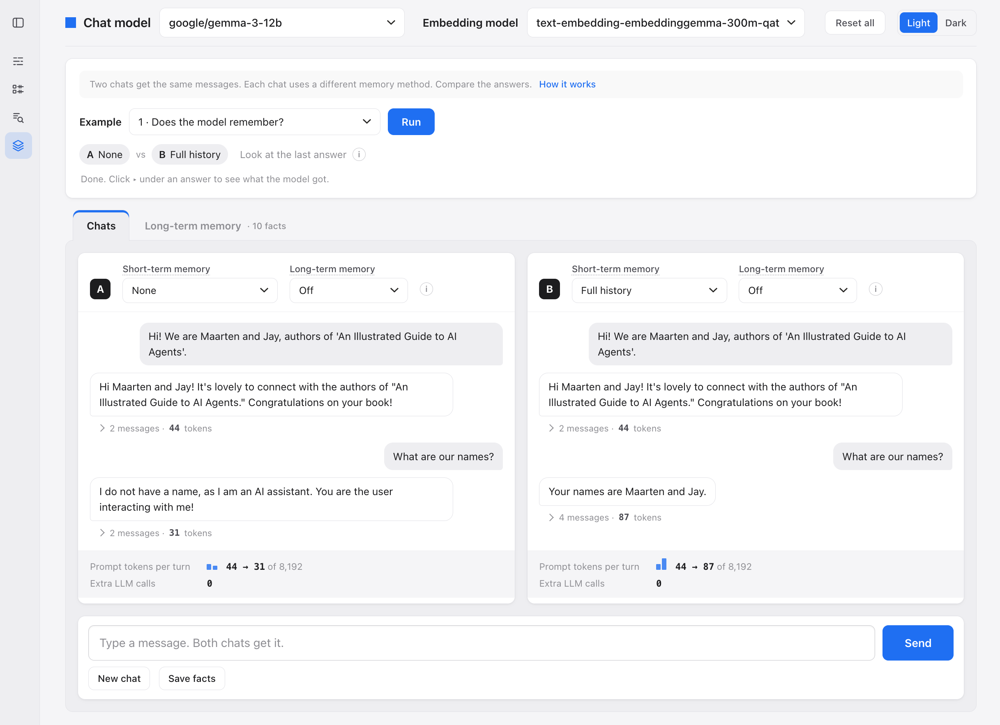

**2 · What does trimming forget?** A keeps only the last 2 turns, so it does not know the book. B knows the book, but its prompt grows from 40 to 211 tokens.

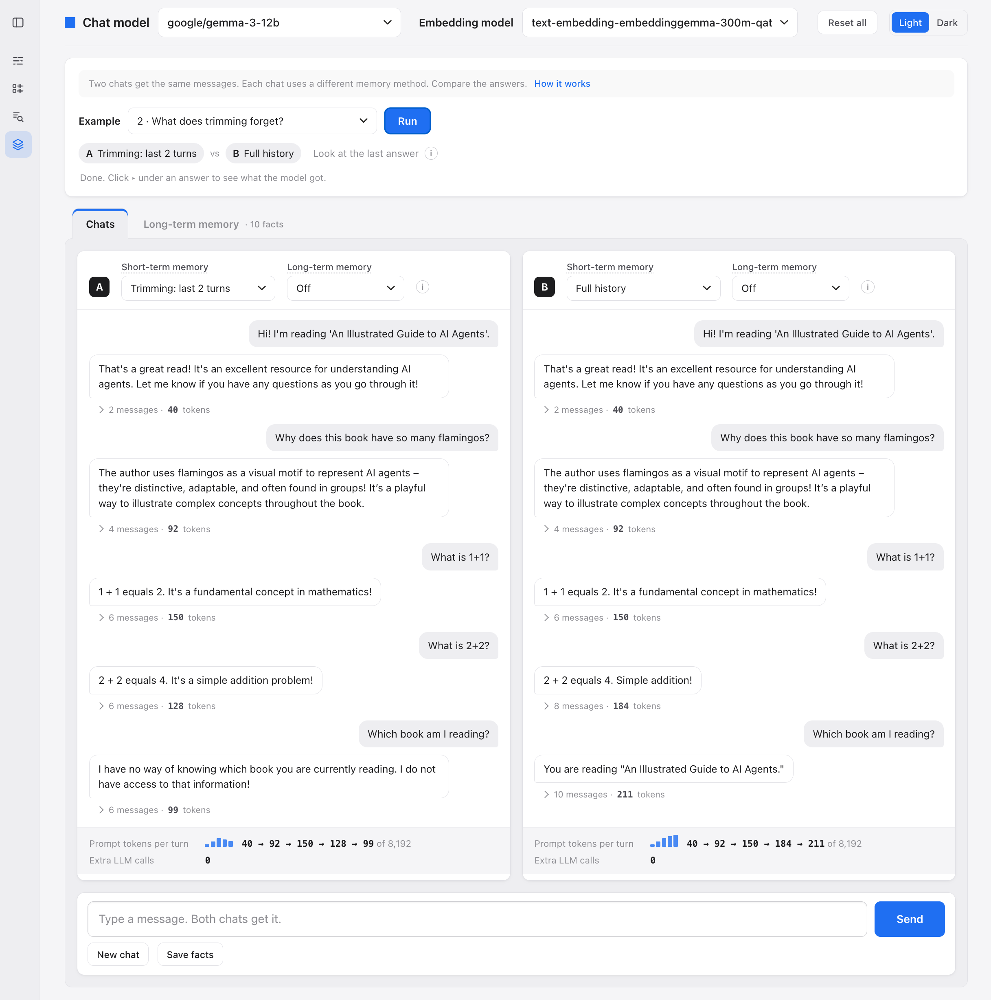

**3 · Can a summary replace the history?** Both know the name Sarah. A sends a running summary: 39 → 119 tokens, with 5 extra LLM calls. B sends all messages: 39 → 242 tokens.

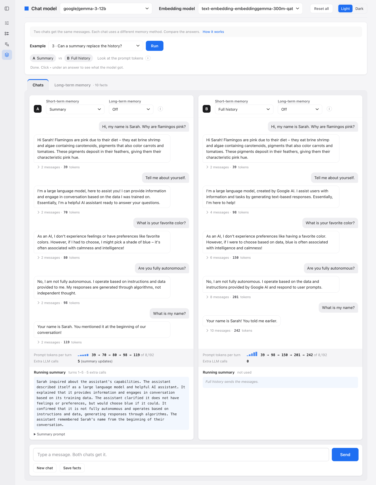

**4 · Which saved facts go to the model?** The 10 facts of the book are in the long-term memory first. A (RAG: top 3) sends the 3 nearest facts: about 70 tokens. B (Memory files) sends all 10 facts in the system prompt: about 480 tokens. Both answers are correct.

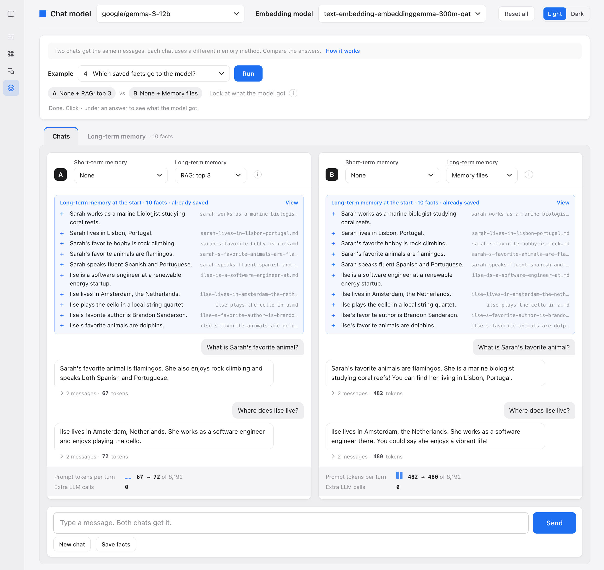

The **Long-term memory** tab shows the two stores: the .md files that B uses, and the vectors in Chroma that A uses.

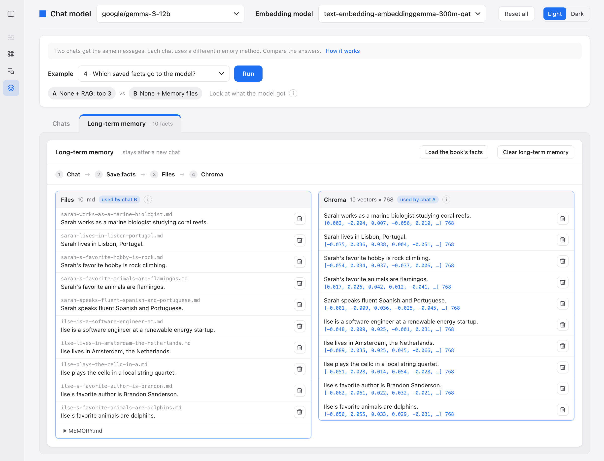

**5 · Does it remember you in a new chat?** The facts about Sam are saved, then a new chat starts. A (Memory files) knows Sam. B (long-term memory Off) knows nothing.

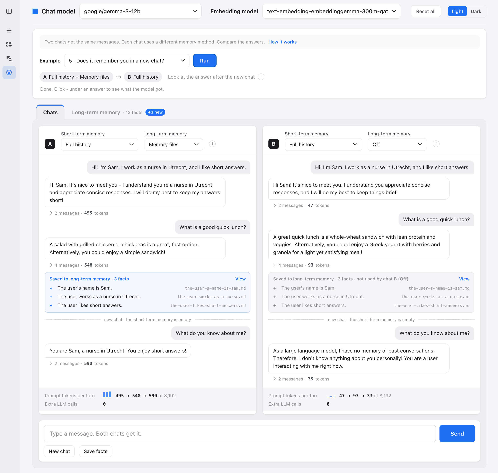

The 3 new facts are in both stores: the page writes the file and embeds the fact when it saves it.

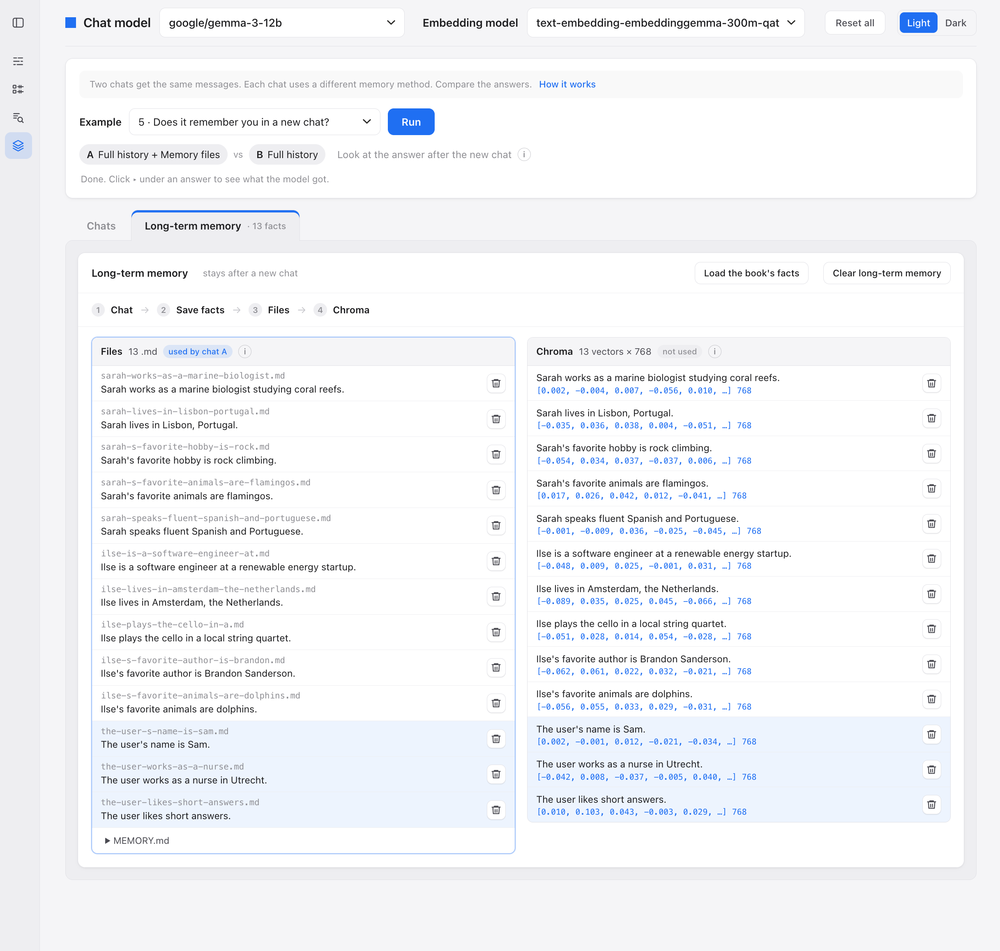

## Tools

Open **Tools** in the sidebar. The page is a playground for tool usage. You trace every step of how an LLM uses a tool, from your question to the final answer. The tools go into the prompt (in-context learning), the model writes a tool call, and the harness runs the tool and sends the result back.

The page is built on the [tool use API of LM Studio](https://lmstudio.ai/docs/developer/openai-compat/tools), which follows the format of the OpenAI Function Calling API. The harness sends the tool list in the `tools` parameter of the request: the tool definition (a JSON schema) of each tool that is on. LM Studio puts the tool definitions into the prompt with the chat template of the model, and converts the tool call of the model into `tool_calls` in the response.

The page has two tabs:

- **Tools:** your tools. Each tool shows its **Tool creation** (the function name, the description, the parameters, and the URL or the Python code that runs) and its **Tool definition** (the JSON schema that the harness makes from them). The **+** menu in the message box shows the display name of each tool. The model gets the function name. Click **Create tool** to write your own (a GET request to a URL), or **Add from the library…** to add a ready tool, like **crypto_price**. Only the tools that are **On** go to the model.
- **Chat:** ask a question and follow the rows. Each row shows who does the work: the **Harness**, **LM Studio**, the **Model** or the **Tool**. Click **Details** to see what passed through that step.

### What you can do

- **Follow a tool call from start to finish.** Ask "What is the price of Bitcoin today?" and follow the five steps of tool usage: tool creation, tool definition, tool selection, tool calling and output processing. The model writes the call, LM Studio converts it to JSON, the harness validates it and calls Coinbase, and the model writes the answer from the result.
- **Inspect the prompt and the tokens.** Open **Applying chat template** to see where your tools go in the prompt, and **Generating tokens** to see the tool call as the model wrote it.
- **Compare tools for the same question.** Turn on **exchange_rate** and ask for the price of Bitcoin in CAD in two ways. Each tool uses different data.
- **Write guardrails.** Put a rule in the **System prompt**, or select one from the **Examples** menu, and see how it changes tool selection. **Permissions** (Deny all, Ask every time, Allow all) control which tools run.
- **Compare models.** Load a small model, like Gemma 3 1B, and ask the same questions. **Validating tool call** shows the calls that do not match the schema.
- **Create your own tools.** Give a name, a description, a URL and parameters, and see how well each model uses them.
- **Revisit a demonstration.** Each chat is archived when a message finishes. Click **Archived** to open an archived chat again, with all its steps and the settings of the run. An archived chat is read only: click **New** to start a new chat.
- **Chain tool calls.** The library has **power** and **future_value** (math.js), for example to get the price of Bitcoin and then calculate its value in 10 years at 10% a year. **multiply** returns large numbers in fixed notation, not like `1.9e+5`.

**Reasoning between tool calls.** A reasoning model like Gemma 4 plans before it calls a tool. The harness sends that reasoning back with the tool result (`reasoning_content` in the assistant message), so the model keeps its plan during one turn. When you send a new question, the harness removes the old reasoning. This follows the [Gemma 4 thinking guide](https://ai.google.dev/gemma/docs/capabilities/thinking). In **Messages**, click `reasoning_content` to see the full text. **Parsing output** shows what LM Studio found in the output: `reasoning_content`, `content` and `tool_calls`.

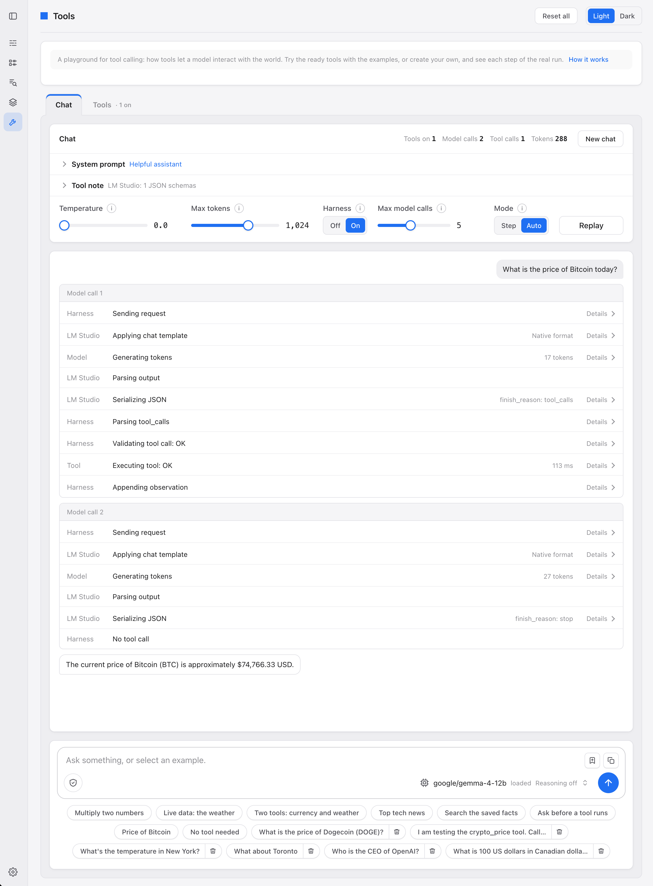

Your tools are in `tools.json`, and your archived chats are in `chats/`. Git ignores them.

## Limitations

These limitations come from LM Studio:

- LM Studio returns a maximum of 10 candidates for each token.
- LM Studio returns no probabilities for reasoning (thinking) tokens. LM Trace shows the reasoning as text only.
- LM Studio does not return the stop token. LM Trace adds an end marker.
- With structured output, LM Studio does not return the tokens that the schema forces, for example keys and braces.
- With structured output, the model cannot use its thinking mode. To get reasoning, put a `reasoning` field first in the schema.
- LM Studio does not return the embeddings of a chat model. The page reads them from the safetensors files of the model.
- The SDK returns token IDs only. The page finds the text of each token from the prefixes of the input.
- The SDK tokenizes the text without the chat template. The **Model input** section of the Trace page shows the full text with the template and its special tokens.

## References and credits

Thank you to the authors of these works. They are the basis of the ideas and examples in LM Trace.

- Wei et al. (2022). [Chain-of-Thought Prompting Elicits Reasoning in Large Language Models](https://arxiv.org/abs/2201.11903).
- Kojima et al. (2022). [Large Language Models are Zero-Shot Reasoners](https://arxiv.org/abs/2205.11916).
- Renze & Guven (2024). [The Benefits of a Concise Chain of Thought on Problem-Solving in Large Language Models](https://arxiv.org/abs/2401.05618).
- Jay Alammar and Maarten Grootendorst. [An Illustrated Guide to AI Agents](https://learning.oreilly.com/library/view/an-illustrated-guide/9798341662681/). O'Reilly. The book explains how language models reason, from chain-of-thought prompting to reasoning models trained with reinforcement learning. The penguin and flamingo examples in LM Trace come from this book. The examples on the Memory page come from chapter 4 ([code](https://github.com/HandsOnLLM/An-Illustrated-Guide-To-AI-Agents/tree/main/chapter04)).
- LM Studio. [Tool Use](https://lmstudio.ai/docs/developer/openai-compat/tools). The OpenAI-compatible tool use API that the Tools page is built on.
