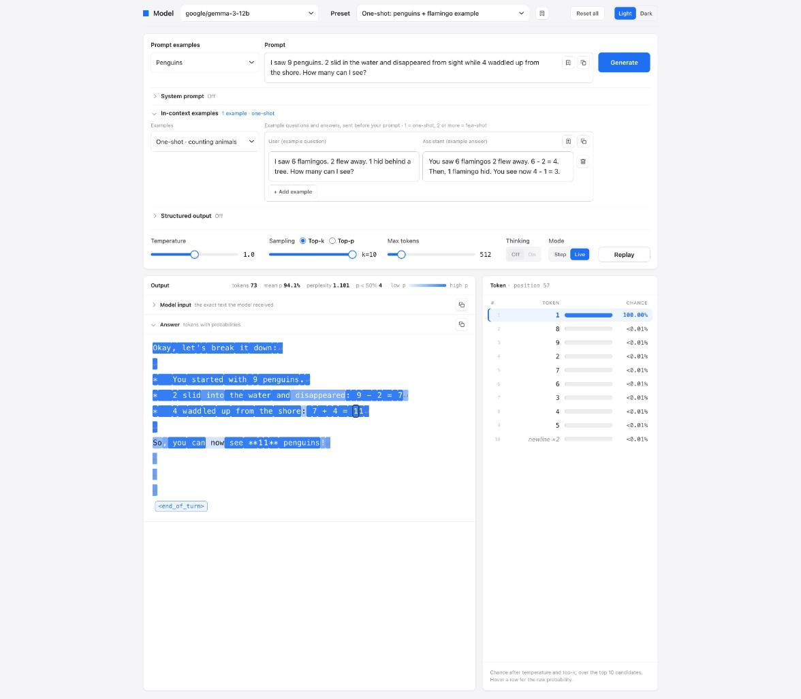

# Token Viewer

Token Viewer shows how a language model generates text, one token at a time. It uses a model that runs locally in [LM Studio](https://lmstudio.ai).



## Purpose

Use Token Viewer to learn how generation works. For each token, you can see:

- The token that the model selected.
- The 10 most probable candidates and their probabilities.
- How temperature, top-k and top-p change the probabilities.
- The exact text that the model received, with the chat template and special tokens.

You can also compare prompt methods: zero-shot, one-shot, few-shot, chain-of-thought, system prompts and structured output (JSON schema).

## Requirements

- macOS, Windows or Linux.
- LM Studio, with one or more models downloaded.
- Python 3. The server uses only the Python standard library.
- Optional: the `lms` command-line tool. It comes with LM Studio. Token Viewer needs it to show the model input.

## Set up LM Studio

1. Install LM Studio.
2. Download a model. Example: `google/gemma-3-12b`.
3. Start the local server. Use one of these methods:
   - In LM Studio, open **Developer** and set the server status to **Running**.
   - In a terminal, run `lms server start`.
4. Make sure that the server uses port 1234. This is the default.
5. Load a model, or keep **Just-in-Time Model Loading** on. With this setting, LM Studio loads a model when Token Viewer sends a request to it.

You do not have to enable CORS. The Token Viewer server sends the requests to LM Studio.

## Start Token Viewer

```sh
git clone https://github.com/VincentSchaik/token-viewer.git
cd token-viewer
python3 server.py
```

Open http://localhost:8765 in your browser.

To change the defaults, set these environment variables before you start the server:

| Variable | Default | Function |
|---|---|---|
| `PORT` | `8765` | Port of Token Viewer |
| `LMS_URL` | `http://localhost:1234` | Address of the LM Studio server |
| `LM_API_TOKEN` | not set | API token, if LM Studio requires authentication |

## Use Token Viewer

1. Select a model.
2. Type a prompt, or select an example or a preset.
3. Optional: open **System prompt**, **In-context examples** or **Structured output**.
4. Click **Generate**.
5. In **Step** mode, press → or Space to add one token at a time. In **Live** mode, the tokens appear as the model generates them.
6. Click a token to see its candidates.

A darker color shows a token that the model was more sure of.

The server keeps your saved prompts, examples, schemas and presets in JSON files in the project folder. Git ignores these files.

## Limitations

These limitations come from LM Studio:

- LM Studio returns a maximum of 10 candidates for each token.
- LM Studio returns no probabilities for reasoning (thinking) tokens. Token Viewer shows the reasoning as text only.
- LM Studio does not return the stop token. Token Viewer adds an end marker.
- With structured output, LM Studio does not return the tokens that the schema forces, for example keys and braces.
- With structured output, the model cannot use its thinking mode. To get reasoning, put a `reasoning` field first in the schema.
